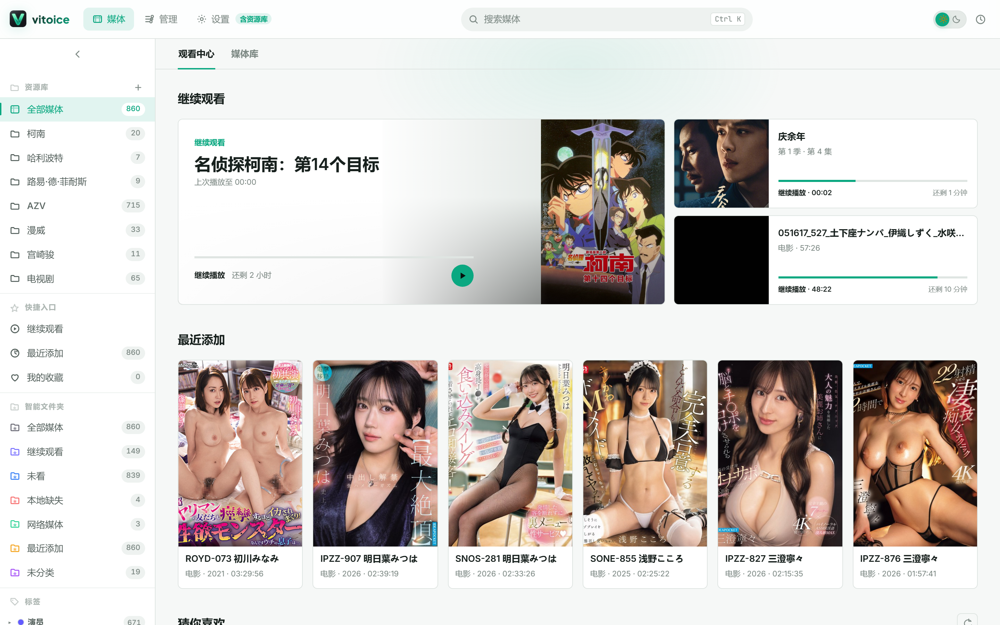
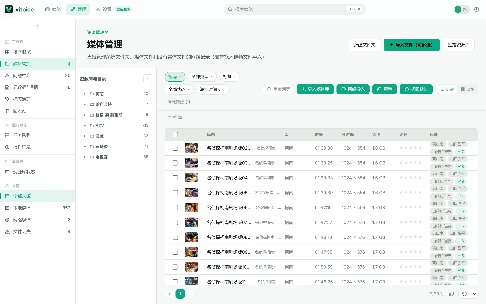

# vitoice

**媒体播放 + 媒体管理的融合体** —— 桌面软件里「会整理的播放器，会播放的管理器」。

市场上要么是纯播放器（PotPlayer / IINA），要么是纯管理工具（Eagle / Pixcall）。vitoice 的目标是把两件事合成一件：**播放即整理**。

> 播放器负责看，管理器负责剪、分、存。vitoice 让这两套工作流无缝衔接——播放中随手打点，进度与收藏自动沉淀进媒体库。

## 界面预览

**媒体页**（媒体库 · 网格视图 + 左侧资源导航 + 多维筛选）：



**管理页**（管理中心 · 资源管理器 / 媒体管理 / 问题中心等工作台）：



> 媒体页左栏按「全部媒体 / 继续观看 / 智能文件夹 / 标签 / 类型」组织资源，主区支持 网格 / 列表 / 紧凑 三种视图，并按题材、地区、年份、分辨率、评分、时长、进度多维筛选。管理页提供资源管理器、媒体管理、问题中心、元数据与刮削、标签治理、回收站、任务队列等工作台。

## 功能总览

**播放半身**
- 全屏播放器：手势快进、倍速记忆（按媒体存后端）、音量 / 字幕轨按媒体记忆
- 片段标记：播放中打点标记精华片段，快速跳转
- 多源播放：本地文件 / 网络直链 / HLS（含清晰度切换与记忆）
- 迷你置顶小窗：边干活边看，进度与主窗口双向同步
- 继续观看 / 观看中心：进度、观看状态自动记录

**管理半身**
- 多库管理：目录树导航、文件监控（watcher 自动感知增删改）
- 智能刮削：TMDB 电影 / 剧集 + 本地 AV 刮削链，刮削数据源可配置回退
- AI 标签：接入 AI 服务自动打标
- 系列聚合：剧集自动聚合成系列视图
- 批量操作：打标 / 评分 / 移动 / 模板化改名（`{title} ({year})`、`{series} S{season}E{episode}`）/ 导出
- 回收站：软删除 + 一键恢复 + 永久清理；删除支持 10 秒撤销
- 智能文件夹：规则驱动的动态收藏夹
- 重复文件检测：内容哈希 / 同名 / 同大小三模式查重向导
- 文件导入：服务端导入（复制 / 移动 + 同名冲突自动后缀 + 格式过滤）+ 拖拽导入
- 网络媒体：URL 导入、受限内容门控、只删本地文件保留网络源

## 技术栈

| 层 | 技术 |
|---|---|
| 前端 | Svelte 5 (runes) + SvelteKit + adapter-static |
| 桌面壳 | Tauri v2 (Rust) |
| 后端 | FastAPI + SQLAlchemy (async) + SQLite |

## 安装与使用

> 面向打包产物（安装版）的用户操作说明，见 [使用说明](docs/使用说明.md)。

### 快速上手（安装版）
1. 运行安装程序启动 vitoice，首次进入媒体库为空。
2. 在「管理 → 媒体库」中添加需要管理的目录（本地文件夹 / 挂载盘）。
3. 首次添加即可触发刮削；如未命中元数据，可到单条媒体上手动触发 TMDB 补刮。
4. 在「设置」中按需填入 **TMDB API key**（用于元数据刮削）与 **AI 服务 key**（用于自动打标）。
5. 双击任意媒体进入播放器，播放中按快捷键即可打点标记 / 倍速 / 定位片段。

### 开发启动
```powershell
# 前置：Node 18+ / Python 3.12+ / Rust stable
# 后端（backend/.venv 优先，VITOICE_ENV=dev 使用 backend/data/vitoice_dev.db）
.\start-backend.ps1          # uvicorn @ 127.0.0.1:8765

# 客户端（前端 Vite + Rust 自动编译，会一并拉起 Python 后端）
.\dev.ps1
```

生产构建：`cd src-tauri && cargo tauri build`（前端 bundle + Rust 二进制 + sidecar）。

## 目录结构

```
frontend/          # SvelteKit 前端（端口 5173）
backend/           # FastAPI 后端（端口 8765），alembic 迁移链
src-tauri/         # Tauri 桌面壳 + capabilities 权限配置
doc/               # 设计文档与审计报告
docs/              # 面向使用者的说明文档
```

## 配置说明

- TMDB API key、AI 服务 key 均在应用内「设置」页填写，存于本地数据库，**不写入代码仓库**
- 数据库：生产 `~/.vitoice/vitoice.db`，开发 `backend/data/vitoice_dev.db`

## 安全说明

- 仓库不含任何密钥 / 令牌；本地脚本如需调用外部 API，请将 key 放入 `.env` 或被 `.gitignore` 忽略的 `*.local.ps1`
- `generate_image_makabaka.ps1` 从环境变量 `MAKABAKA_API_KEY` 读取密钥，不硬编码
- 受限内容（AV 库）默认隐藏，由「显示限制内容」开关 + 网络源开关双重门控

> **历史遗留（2026-09-02 已处置）**：早期版本曾把 makabaka API key 硬编码进 `generate_image_makabaka.ps1` 并提交，后经 `filter-branch` 重写历史，但 `refs/original/*` 备份引用未清除，导致含密钥的 blob 长期滞留在本地 `.git` 中。现已删除备份引用并执行 `reflog expire` + `gc`，对象库已无该 blob。**若你曾 clone 过本仓库，请视为该 key 已泄漏并到服务商处吊销。**

## License

[MIT](LICENSE)